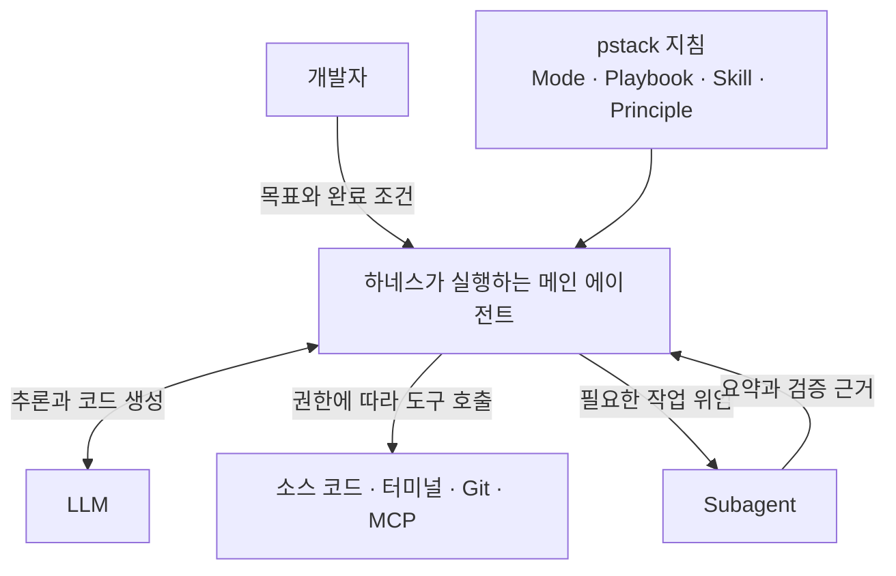
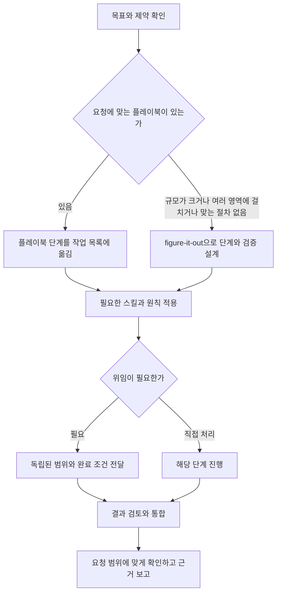
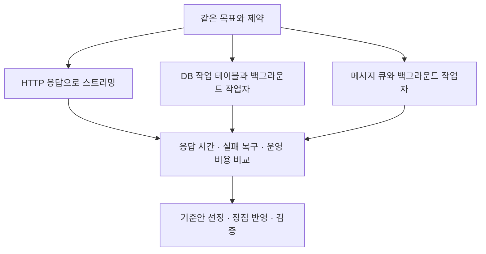
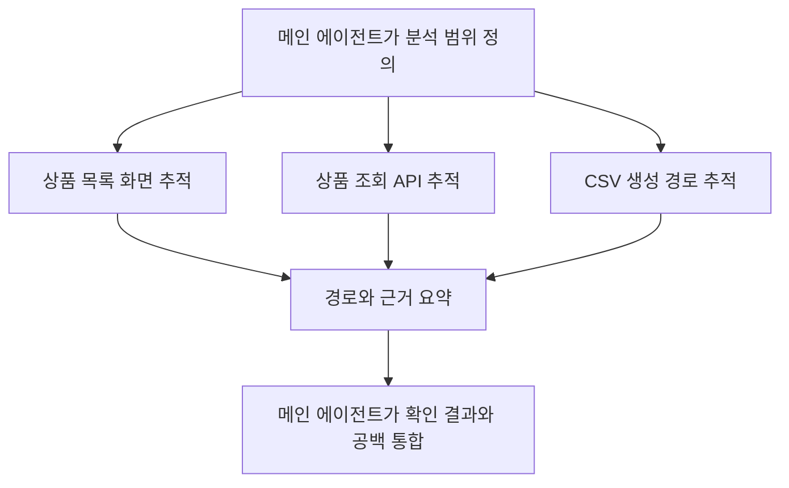
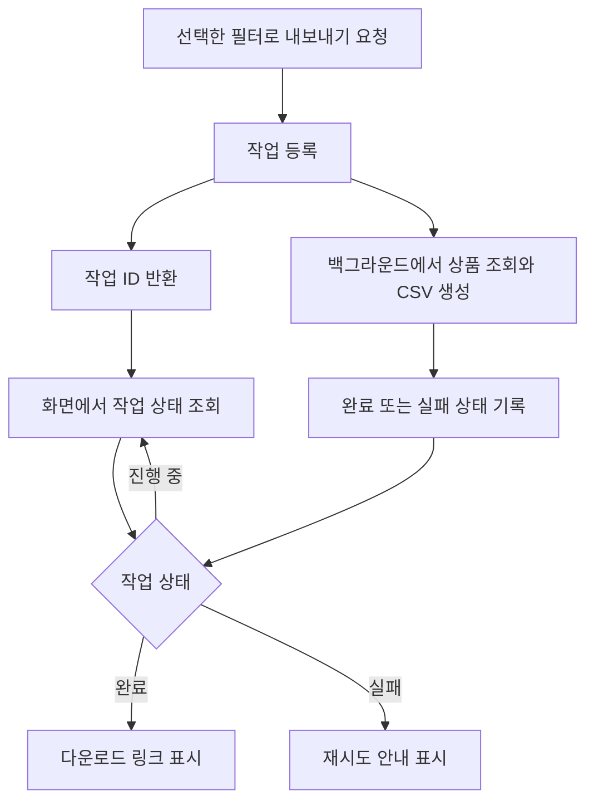
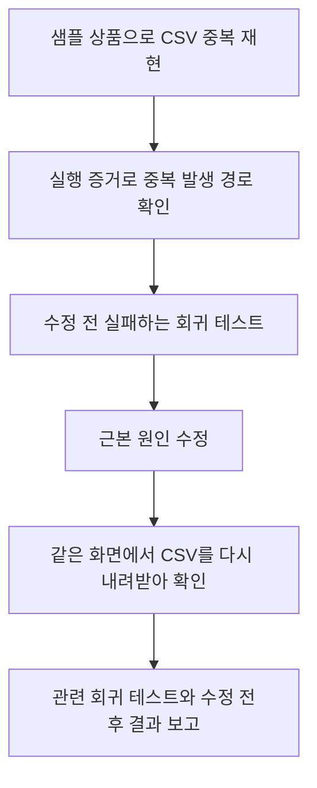

## 들어가며

AI 코딩 도구에 버그 수정을 맡길 때마다 같은 말을 덧붙인다고 해 보겠습니다.

> 기존 API 응답 형식은 유지해 주세요. 수정하기 전에 버그를 재현하고, 수정한 뒤에는 샘플 데이터로 앱을 띄워 같은 동작을 다시 확인해 주세요.

같은 저장소를 쓰는 팀원도 새 대화를 열 때마다 이 규칙과 절차를 설명합니다. 누군가는 앱을 직접 띄워 보고, 누군가는 테스트 결과만 PR에 남깁니다. 리뷰어는 그때마다 어떤 조건에서 무엇을 확인했는지 다시 묻게 됩니다.

‘AI 코딩 도구를 활용한 팀 협업’ 시리즈에서는 이렇게 개인의 대화에 흩어져 있던 규칙과 작업 절차를 저장소에 옮기고, 팀원이 Git으로 함께 관리하는 방법을 살펴봅니다. 첫 편에서는 **pstack이 개발 작업을 이끄는 방식과 앱의 검증 절차를 팀이 재사용할 수 있는 파일로 만드는 과정**을 다룹니다.

## 1. pstack이란?

pstack은 Lauren Tan(`poteto`)이 자신의 개발 방식을 정리해 공개한 AI 코딩 에이전트용 워크플로우 프레임워크입니다. 에이전트가 따를 작업 절차(플레이북), 특정 작업을 맡길 때 쓰는 지침(스킬), 변경 결과를 실행해서 확인하는 등의 작업 원칙을 플러그인으로 묶었습니다. 같은 모델을 써도 팀이 요구하는 조사 깊이와 검증 기준을 작업에 반복해서 적용할 수 있습니다. [pstack 원본 저장소 README](https://github.com/cursor/plugins/blob/b7b93c36be9bcc36a74db438e0fd385d660bc559/pstack/README.md), [플러그인 정의](https://github.com/cursor/plugins/blob/b7b93c36be9bcc36a74db438e0fd385d660bc559/harness/pstack/claude-code/.claude-plugin/plugin.json)

### Agent Harness와 pstack이 맡는 일

LLM은 요구사항을 이해하고, 코드와 실행 결과를 바탕으로 다음 행동을 판단합니다. **Agent Harness**는 모델이 파일을 읽고 수정하거나 터미널 명령을 실행할 수 있도록 도구를 제공하고, 권한과 컨텍스트를 관리하는 실행 환경입니다. Claude Code는 여기에 스킬 로딩, Hooks, 서브에이전트 실행, MCP 연동 등을 제공합니다. pstack은 이 환경에서 에이전트가 어떤 순서로 일하고 무엇을 확인할지 정의합니다. 아래 그림은 이 관계를 설명하기 위한 개념도입니다. [pstack 개발 가이드](https://github.com/cursor/plugins/blob/b7b93c36be9bcc36a74db438e0fd385d660bc559/pstack/docs/guide/README.md), [Claude Code 어댑터](https://github.com/cursor/plugins/blob/b7b93c36be9bcc36a74db438e0fd385d660bc559/pstack/docs/harness/claude-code.md)



| 구성 요소 | 맡는 일 | 상품 관리 웹 서비스의 예 |
| --- | --- | --- |
| Mode | 목표를 해석하고 작업 흐름을 이끄는 진입점 | CSV에 상품이 중복된다는 신고를 버그 수정 요청으로 판단 |
| Playbook | 작업 유형에 맞는 단계와 완료 근거 정의 | 재현, 원인 확인, 수정, 같은 조건에서 재검증 |
| Skill | 특정 작업에 쓰는 재사용 가능한 지침과 보조 자료 | `how`로 상품 조회부터 CSV 생성까지 추적 |
| Principle | 상황에 따라 적용하는 엔지니어링 판단 기준 | 내보낸 CSV에 상품마다 한 행이 있는지 확인 |
| Subagent | 별도 컨텍스트에서 범위가 정해진 작업을 수행하는 에이전트 | 상품 조회 모듈을 조사하고 관련 코드 경로와 근거를 보고 |

Poteto Mode도 `SKILL.md`로 정의된 스킬입니다. 그 안에서 플레이북과 원칙을 찾아 읽고 다른 스킬을 연결합니다. 원칙도 각각 `principle-*` 스킬에 정의돼 있습니다. 서브에이전트는 하네스가 실행하며, 메인 에이전트가 작업 목록과 위임 범위를 관리하고 결과를 검토합니다. [Poteto Mode 스킬 정의](https://github.com/cursor/plugins/blob/b7b93c36be9bcc36a74db438e0fd385d660bc559/pstack/skills/poteto-mode/SKILL.md), [`poteto-agent` 정의](https://github.com/cursor/plugins/blob/b7b93c36be9bcc36a74db438e0fd385d660bc559/pstack/agents/poteto-agent.md)

### 일반 AI 코딩 에이전트와 비교하기

일반 에이전트에도 재현, 설계 비교, 회귀 테스트를 요청할 수 있습니다. pstack을 쓰면 팀이 이 절차를 요청마다 처음부터 설명하는 수고를 줄일 수 있습니다. 아래 표와 그림은 두 환경에서 같은 버그 수정 요청을 처리할 수 있는 방식을 보여 주는 개념 예시입니다.

| 비교 항목 | 일반 AI 코딩 에이전트 | pstack 적용 환경 |
| --- | --- | --- |
| 요구사항과 작업 절차 | 프롬프트, 프로젝트 지침, 에이전트 판단으로 절차 구성 | 목표를 다시 설명하고 맞는 플레이북의 단계를 작업 목록에 옮김 |
| 설계와 영향 범위 | 필요에 따라 설계 검토와 영향도 조사를 요청 | `architect`, `arena`, `blast-radius` 등으로 범위와 검토 방법을 구체화 |
| 작업 분할과 병렬 실행 | 에이전트 또는 사용자가 작업 분할 결정 | `swarm`은 분담이나 경쟁 실행을, `arena`는 후보 비교를 구조화 |
| 테스트와 리뷰 | 과업과 설정에 따라 검증 깊이가 달라짐 | 플레이북에 따라 재현, 실제 동작 확인, 리뷰 근거 보고 |
| 비용과 일관성 | 작은 작업은 짧게 끝날 수 있고 절차는 작업마다 달라질 수 있음 | 같은 검증 순서를 재사용하기 쉽고 병렬 실행과 검토 비용이 추가될 수 있음 |


### Claude Code에 설치하기

pstack은 Cursor용으로 만들어졌으며, 공식 저장소는 이 원본을 바탕으로 생성한 Claude Code용 플러그인도 제공합니다. 이 글의 설치와 실습은 Claude Code를 기준으로 합니다. [공식 배포 구조](https://github.com/cursor/plugins/blob/b7b93c36be9bcc36a74db438e0fd385d660bc559/harness/pstack/README.md)

Claude Code 대화창에서 아래 두 명령을 순서대로 입력합니다. 첫 명령은 배포 마켓플레이스를 등록하고, 두 번째 명령은 pstack을 설치합니다. [공식 설치 안내](https://github.com/cursor/plugins/blob/b7b93c36be9bcc36a74db438e0fd385d660bc559/pstack/README.md#install)

```text
/plugin marketplace add cursor/plugins
/plugin install pstack@cursor-plugins
```

설치 후 `/pstack:setup-pstack`으로 역할별 모델과 추론 예산을 설정할 수 있습니다. 설정은 `~/.claude/rules/pstack-models.md`에 저장됩니다. 설정을 마치면 새 대화에서 `/pstack:poteto-mode <요청>`으로 작업을 시작합니다. [Claude Code 초기 설정](https://github.com/cursor/plugins/blob/b7b93c36be9bcc36a74db438e0fd385d660bc559/pstack/docs/harness/claude-code.md#setup-pstack)

공식 저장소에서 Claude Code가 설치하는 플러그인의 주요 경로는 아래와 같습니다. 팀에서 직접 만드는 검증 스킬은 4절에서 다룹니다. [Claude Code용 플러그인](https://github.com/cursor/plugins/tree/b7b93c36be9bcc36a74db438e0fd385d660bc559/harness/pstack/claude-code)

```text
harness/pstack/claude-code/
├── .claude-plugin/plugin.json
├── agents/poteto-agent.md
├── docs/harness/claude-code.md
└── skills/
    ├── poteto-mode/
    │   ├── SKILL.md
    │   ├── worker.md
    │   └── playbooks/
    ├── arena/SKILL.md
    └── principle-model-the-domain/SKILL.md
```

## 2. Poteto Mode는 어떻게 작업을 진행하나요?

Poteto는 작성자의 닉네임입니다. Claude Code에서 `/pstack:poteto-mode`로 작업을 요청하면 메인 에이전트가 **목표와 이를 충족하는 가장 작은 변경**을 자기 말로 정리합니다. 이어 맞는 플레이북을 읽고 그 단계를 작업 목록에 옮깁니다. 각 단계에서 필요한 스킬과 원칙을 읽고, 위임이 필요한 경우 파일 경로와 완료 조건을 서브에이전트에게 전달합니다. 플레이북에서 직접 위임할 때는 `poteto-agent`를 쓰라는 지침이 있으며, `swarm`과 `interrogate`는 각 스킬이 지정한 작업자 유형을 사용합니다. [Poteto Mode 가이드](https://github.com/cursor/plugins/blob/b7b93c36be9bcc36a74db438e0fd385d660bc559/pstack/docs/guide/02-poteto-mode.md), [Poteto Mode 스킬 정의](https://github.com/cursor/plugins/blob/b7b93c36be9bcc36a74db438e0fd385d660bc559/pstack/skills/poteto-mode/SKILL.md), [작업자 공통 지침](https://github.com/cursor/plugins/blob/b7b93c36be9bcc36a74db438e0fd385d660bc559/pstack/skills/poteto-mode/worker.md)



이 그림은 Markdown 지침에 따라 에이전트가 판단하는 흐름을 요약합니다. 같은 요청도 모델, 코드베이스, 컨텍스트와 하네스에서 허용한 도구에 따라 수행 과정이 달라질 수 있습니다. 읽기 전용 조사라면 코드 추적과 근거 제시가 결과물이고, 버그 수정이라면 증상을 재현한 경로에서 수정 후 동작을 확인합니다. [Investigation 플레이북](https://github.com/cursor/plugins/blob/b7b93c36be9bcc36a74db438e0fd385d660bc559/pstack/skills/poteto-mode/playbooks/investigation.md), [Bug fix 플레이북](https://github.com/cursor/plugins/blob/b7b93c36be9bcc36a74db438e0fd385d660bc559/pstack/skills/poteto-mode/playbooks/bug-fix.md)

### 어떤 플레이북이 선택되나요?

| 요청 예시 | 플레이북 또는 스킬 | 수행 방식 |
| --- | --- | --- |
| 상품 목록에서 적용한 필터가 CSV에 어떻게 반영되나요? | `investigation.md` | 읽기 전용으로 관련 경로를 추적하고 근거를 제시합니다. |
| 카테고리가 여러 개인 상품이 CSV에 중복됩니다. | `bug-fix.md` | 실행 중 증상과 원인을 확인하고 수정 후 같은 조건에서 재검증합니다. |
| 상품 목록에 판매 상태 필터를 추가해 주세요. | `feature.md` | 데이터 구조와 모듈 경계를 설계한 뒤 구현하고 실제 사용 경로를 확인합니다. |
| 출력을 유지하면서 CSV 생성 코드를 정리해 주세요. | `refactoring.md` | 기존 동작을 테스트, 스냅샷 또는 비교용 실행 결과로 먼저 고정합니다. |
| 상품 수가 많으면 CSV 다운로드가 느려집니다. | `perf-issue.md` | 기준 측정과 프로파일을 확보하고 수정 전후의 실행 결과를 비교합니다. |
| 한 지표의 목표값까지 여러 개선을 검증해 주세요. | `hillclimb.md` | 기준값을 두고 가설과 측정을 반복합니다. |
| 이 PR의 리뷰와 CI 상태를 확인해 주세요. | `babysit.md` | `check`로 한 차례 확인하거나, `drive`로 병합 준비 상태까지 진행합니다. |
| 이전 세션에서 멈춘 작업을 이어 주세요. | `session-pickup.md` | 이전 기록과 브랜치 상태를 읽고 남은 작업에 맞는 플레이북으로 넘깁니다. |
| 여러 모듈을 걸치는 마이그레이션 절차를 설계해 주세요. | `figure-it-out` 스킬 | 기존 절차로 다루기 어려운 작업에 맞춰 단계, 검증 방법, 결정 기록을 설계합니다. |

Poteto Mode에는 22개 플레이북이 정의돼 있습니다. 위 표 외에도 프로토타입, 런타임·트레이스 조사, PR 열기와 병합, 여러 단계에 걸친 계획 등이 포함됩니다. 구현 플레이북은 `Opening a PR`까지 이어질 수 있으므로 로컬 수정만 맡길 때는 커밋, 푸시, PR 생성의 범위를 프롬프트에 적어 둡니다. [전체 플레이북 디렉터리](https://github.com/cursor/plugins/tree/b7b93c36be9bcc36a74db438e0fd385d660bc559/pstack/skills/poteto-mode/playbooks), [`figure-it-out` 정의](https://github.com/cursor/plugins/blob/b7b93c36be9bcc36a74db438e0fd385d660bc559/pstack/skills/figure-it-out/SKILL.md), [Opening a PR 플레이북](https://github.com/cursor/plugins/blob/b7b93c36be9bcc36a74db438e0fd385d660bc559/pstack/skills/poteto-mode/playbooks/opening-a-pr.md)

### 한 세션에서 이어 쓰기와 종료하기

`/pstack:poteto-mode`로 불러온 스킬 본문은 같은 대화의 후속 턴에 남습니다. 컨텍스트가 압축되면 보존 예산이 적용됩니다. 이전 작업의 지침을 비우고 시작하려면 `/clear`로 새 대화를 엽니다. [Claude Code 스킬 컨텍스트 수명](https://code.claude.com/docs/en/skills#skill-content-lifecycle), [Claude Code 명령 참조](https://code.claude.com/docs/en/commands)

현재 대화에서 주제를 바꿀 때는 `/pstack:poteto-mode new task. 상품 목록의 기본 정렬 기준을 조사해 주세요. 코드 수정은 하지 마세요.`처럼 새 작업임을 명시하면 플레이북을 다시 선택하도록 유도할 수 있습니다. [작업 전환 가이드](https://github.com/cursor/plugins/blob/b7b93c36be9bcc36a74db438e0fd385d660bc559/pstack/docs/guide/02-poteto-mode.md#switch-tasks-with-new-task)

## 3. 작업에 맞는 스킬과 원칙 고르기

Poteto Mode에서는 플레이북이 필요한 스킬을 이어서 읽습니다. 조사나 검토 하나만 필요하면 해당 스킬을 직접 호출할 수 있습니다. 아래 명령은 가상의 상품 관리 웹 서비스에서 할 수 있는 요청입니다. 각 행에 연결한 `SKILL.md`에서 실제 수행 절차를 확인할 수 있습니다.

| 직접 호출 예시 | 이런 상황에 사용합니다 |
| --- | --- |
| `/pstack:how 상품 목록의 필터가 CSV에 적용되는 코드 경로를 설명해 주세요.` | 코드에서 데이터 흐름과 모듈의 책임을 확인합니다. 설계 의도를 확인할 때는 `why`를 씁니다. [how](https://github.com/cursor/plugins/blob/b7b93c36be9bcc36a74db438e0fd385d660bc559/pstack/skills/how/SKILL.md) |
| `/pstack:why 상품의 판매 상태를 이렇게 나눈 이유를 찾아 주세요.` | 변경을 도입한 커밋과 PR 논의를 확인하고 기록으로 확인된 사실과 추론을 표시합니다. [why](https://github.com/cursor/plugins/blob/b7b93c36be9bcc36a74db438e0fd385d660bc559/pstack/skills/why/SKILL.md) |
| `/pstack:architect 상품 CSV 내보내기의 상태와 전이를 표현할 설계안을 비교해 주세요. 코드는 수정하지 마세요.` | 영향을 받는 경로를 따라가고 타입, 함수 시그니처, 모듈 경계가 다른 두 구조를 그려 봅니다. 규모가 크거나 쟁점이 많은 설계는 `arena`를 활용합니다. [architect](https://github.com/cursor/plugins/blob/b7b93c36be9bcc36a74db438e0fd385d660bc559/pstack/skills/architect/SKILL.md) |
| `/pstack:arena 대용량 상품 CSV 내보내기 설계안을 같은 기준으로 비교해 주세요.` | 여러 후보가 같은 과제를 독립적으로 수행합니다. 기준에 따라 결과를 평가하고 한 설계로 종합합니다. [arena](https://github.com/cursor/plugins/blob/b7b93c36be9bcc36a74db438e0fd385d660bc559/pstack/skills/arena/SKILL.md) |
| `/pstack:swarm 상품 목록 화면, 조회 API, CSV 생성 경로를 나눠 읽기 전용으로 조사해 주세요.` | 범위를 나눠 맡기거나 같은 작업을 여러 작업자에게 경쟁으로 맡긴 뒤, 근거가 담긴 한 보고서로 모읍니다. [swarm](https://github.com/cursor/plugins/blob/b7b93c36be9bcc36a74db438e0fd385d660bc559/pstack/skills/swarm/SKILL.md) |
| `/pstack:interrogate 이 변경에서 기존 CSV의 열이 누락되는 경우를 찾아 주세요.` | 여러 리뷰어가 실제 실행으로 문제를 입증하고, 메인 에이전트가 재실행해 살아남은 발견 사항을 보고합니다. 수정은 별도 작업으로 맡깁니다. [interrogate](https://github.com/cursor/plugins/blob/b7b93c36be9bcc36a74db438e0fd385d660bc559/pstack/skills/interrogate/SKILL.md) |
| `/pstack:blast-radius 상품 상태 값의 변경이 검색과 CSV 내보내기에 미칠 영향을 확인해 주세요.` | 호출자 목록을 넘어 다른 경로에서 깨질 동작을 찾고, 변경이 안전하다는 가정을 실제 코드 실행으로 확인합니다. [blast-radius](https://github.com/cursor/plugins/blob/b7b93c36be9bcc36a74db438e0fd385d660bc559/pstack/skills/blast-radius/SKILL.md) |
| `/pstack:tdd 같은 상품이 CSV에 두 번 나오는 문제를 재현하는 실패 테스트부터 작성해 주세요.` | 요청에 TDD가 들어 있거나 저렴한 로컬 재현 경로가 있을 때 적합합니다. 무거운 통합 환경이 필요한 경우 가장 가까운 검증 방법을 선택합니다. [tdd](https://github.com/cursor/plugins/blob/b7b93c36be9bcc36a74db438e0fd385d660bc559/pstack/skills/tdd/SKILL.md) |
| `/pstack:unslop 상품 목록 필터 변경을 설명하는 PR 본문을 다듬어 주세요.` | 설명의 의미와 문체를 유지하면서 산문의 군더더기를 줄입니다. 코드 구조 개선에는 리팩터링 플레이북이나 코드 원칙을 적용합니다. [unslop](https://github.com/cursor/plugins/blob/b7b93c36be9bcc36a74db438e0fd385d660bc559/pstack/skills/unslop/SKILL.md) |
| `/pstack:benchmark-checklist CSV 생성 시간 단축을 재현할 수 있는지 확인해 주세요.` | 실행 근거를 통해 병목, 측정 대상, 오류나 생략된 작업, 반복 측정의 편차 등을 확인합니다. [benchmark-checklist](https://github.com/cursor/plugins/blob/b7b93c36be9bcc36a74db438e0fd385d660bc559/pstack/skills/benchmark-checklist/SKILL.md) |
| `/pstack:reflect 이번 작업에서 검증 스킬에 반영할 교훈을 찾아 주세요.` | 현재 대화에서 오래 쓸 교훈을 추려 기존 스킬의 수정안을 제시하고 승인 후 반영합니다. [reflect](https://github.com/cursor/plugins/blob/b7b93c36be9bcc36a74db438e0fd385d660bc559/pstack/skills/reflect/SKILL.md) |
| `/pstack:correct 에이전트가 잘못된 테스트 명령을 반복해서 쓰는 원인을 해결해 주세요.` | 반복 사례를 확인하고 구조, 타입, 린트 또는 테스트에서 재발을 막습니다. 과거 실수가 새 검사에서 실패하는지도 입증합니다. [correct](https://github.com/cursor/plugins/blob/b7b93c36be9bcc36a74db438e0fd385d660bc559/pstack/skills/correct/SKILL.md) |
| `/pstack:show-me-your-work CSV 내보내기를 최적화하면서 검증한 가설과 측정 근거를 남겨 주세요.` | 장시간 작업에서 결정, 이유, 증거 위치, 결과를 결정당 한 행씩 TSV에 적습니다. 기본 기록 경로는 작업 디렉터리의 `decisions.tsv`입니다. [show-me-your-work](https://github.com/cursor/plugins/blob/b7b93c36be9bcc36a74db438e0fd385d660bc559/pstack/skills/show-me-your-work/SKILL.md) |
| `/pstack:ketchup` | 같은 대화에서 사용자의 직전 메시지 이후 달라진 점과 결정할 일을 파악합니다. 이전 세션의 작업을 인계받을 때는 `Session pickup`을 씁니다. [ketchup](https://github.com/cursor/plugins/blob/b7b93c36be9bcc36a74db438e0fd385d660bc559/pstack/skills/ketchup/SKILL.md) |
| `/pstack:poteto-help 상품 목록 화면을 검증하려면 어떤 스킬을 쓰면 되나요?` | 질문에 맞는 사용법과 실행할 프롬프트를 제안받습니다. 도움말을 읽은 뒤 실제 작업은 사용자가 별도로 요청합니다. [poteto-help](https://github.com/cursor/plugins/blob/b7b93c36be9bcc36a74db438e0fd385d660bc559/pstack/skills/poteto-help/SKILL.md) |

### Arena와 Swarm

대용량 상품 CSV를 **어떤 방식으로 제공할지** 판단하려면 Arena가 맞습니다. 예를 들어 후보들이 같은 요구사항을 받아 각자의 작업 위치에서 설계안을 냅니다. 아래 그림의 후보는 설명용입니다. 실제 Arena는 평가 기준을 먼저 정하고, 가능한 경우 메인 에이전트와 다른 모델 공급자의 읽기 전용 평가자를 붙입니다. 메인 에이전트가 모든 후보를 읽고 기준안을 골라 다른 안에서 필요한 부분을 반영한 뒤, 종합 결과를 검증합니다. 후보 작업자의 모델은 설정과 하네스의 지원 범위에 따라 같을 수도 있습니다. [Arena 스킬 정의](https://github.com/cursor/plugins/blob/b7b93c36be9bcc36a74db438e0fd385d660bc559/pstack/skills/arena/SKILL.md), [Claude Code 모델 매핑](https://github.com/cursor/plugins/blob/b7b93c36be9bcc36a74db438e0fd385d660bc559/pstack/docs/harness/claude-code.md#models)



상품 목록 화면, 조회 API, CSV 생성의 **서로 다른 경로를 조사**하려면 Swarm이 맞습니다. 아래처럼 작업자마다 맡을 범위와 확인할 증거를 적고, 메인 에이전트가 범위별 결과와 검증 공백을 확인합니다. 실제 정의에는 분할 외에도 같은 요청을 여러 작업자에게 주는 경쟁 방식과 두 방식을 섞는 방식이 있습니다. 경쟁할 때는 첫 통과, 전체 순위, 최선 결과 중 어느 방식으로 결과를 고를지 시작 전에 정합니다. 쓰기가 필요하면 작업자마다 출력 위치를 분리합니다. [Swarm 스킬 정의](https://github.com/cursor/plugins/blob/b7b93c36be9bcc36a74db438e0fd385d660bc559/pstack/skills/swarm/SKILL.md)



| 비교 항목 | Arena | Swarm |
| --- | --- | --- |
| 기본 질문 | 같은 목표에 어떤 해결책을 택할까요? | 어떤 범위를 누가 맡고, 어떤 결과를 모을까요? |
| 작업 배정 | 후보 모두에게 같은 과제와 별도 작업 위치를 줌 | 분할, 경쟁 또는 혼합 방식으로 범위를 배정 |
| 결과 처리 | 기준안 선정, 필요한 요소 통합, 최종 산출물 검증 | 범위별 결과 및 공백 통합 또는 미리 정한 경쟁 규칙 적용 |

### 검증 기준을 만드는 엔지니어링 원칙

Poteto Mode는 적용할 원칙의 개별 `SKILL.md`를 읽고, 그 원칙이 어떤 판단에 영향을 주었는지 보고하도록 지시합니다. 아래 이름은 공식 스킬의 식별자입니다. [Poteto Mode의 원칙 목록](https://github.com/cursor/plugins/blob/b7b93c36be9bcc36a74db438e0fd385d660bc559/pstack/skills/poteto-mode/SKILL.md#principles)

| 공식 스킬 이름 | 상품 관리 웹 서비스에서의 적용 예 |
| --- | --- |
| `principle-model-the-domain` | CSV 내보내기 작업의 대기·실행·완료·실패 상태를 명시적으로 표현하고 가능한 상태 전이를 정의합니다. [정의](https://github.com/cursor/plugins/blob/b7b93c36be9bcc36a74db438e0fd385d660bc559/pstack/skills/principle-model-the-domain/SKILL.md) |
| `principle-test-behavior-not-implementation` | 같은 필터로 다운로드한 CSV에 대상 상품이 각각 한 행씩 들어 있는지 확인합니다. [정의](https://github.com/cursor/plugins/blob/b7b93c36be9bcc36a74db438e0fd385d660bc559/pstack/skills/principle-test-behavior-not-implementation/SKILL.md) |
| `principle-explain-the-number` | 처리 시간이 줄었다면 실행 중 관측한 병목과 변화 원인을 적고, 캐시 상태나 누락된 행으로 생긴 차이인지 확인합니다. [정의](https://github.com/cursor/plugins/blob/b7b93c36be9bcc36a74db438e0fd385d660bc559/pstack/skills/principle-explain-the-number/SKILL.md) |
| `principle-guard-the-context-window` | 큰 로그와 모듈별 상세 조사는 위임하고 메인 대화에는 결론, 증거 위치, 남은 질문을 남깁니다. [정의](https://github.com/cursor/plugins/blob/b7b93c36be9bcc36a74db438e0fd385d660bc559/pstack/skills/principle-guard-the-context-window/SKILL.md) |
| `principle-sequence-verifiable-units` | 재현 검증, 원인 수정, 회귀 검증을 순서대로 진행합니다. 각 단위에 다음 단계로 넘어갈 조건을 둡니다. [정의](https://github.com/cursor/plugins/blob/b7b93c36be9bcc36a74db438e0fd385d660bc559/pstack/skills/principle-sequence-verifiable-units/SKILL.md) |
| `principle-encode-lessons-in-structure` | 에이전트가 테스트 명령을 반복해서 틀리면 표준 실행 스크립트를 만들고 팀 지침과 CI가 같은 진입점을 쓰도록 맞춥니다. [정의](https://github.com/cursor/plugins/blob/b7b93c36be9bcc36a74db438e0fd385d660bc559/pstack/skills/principle-encode-lessons-in-structure/SKILL.md) |

## 4. 저장소에 팀의 규칙과 검증 절차 남기기

‘기존 API 응답 형식을 유지한다’처럼 여러 작업에 공통으로 적용할 규칙은 저장소 루트의 `CLAUDE.md`에 적을 수 있습니다. ‘샘플 데이터로 앱을 띄우고, 어떤 화면에서 어떤 결과를 확인한다’처럼 순서가 있는 일은 프로젝트 스킬로 둘 수 있습니다. Claude Code는 `.claude/skills/<스킬-이름>/SKILL.md`를 프로젝트 스킬로 읽습니다. [Claude Code 프로젝트 지침 문서](https://code.claude.com/docs/en/memory#choose-where-to-put-claude-md-files), [Claude Code 스킬 문서](https://code.claude.com/docs/en/skills)

pstack의 `/pstack:create-verification-skill`은 저장소를 살펴보고 앱을 시작하는 방법, 기능을 실행하는 방법, 결과를 남기는 방법을 프로젝트 스킬로 정리합니다. 기존 테스트나 실행 스크립트가 있으면 활용하고, 생성 과정에서 대표 기능 하나를 실제로 실행해 절차가 동작하는지 확인합니다. 이 스킬을 Git에 커밋하면 다음 팀원도 같은 절차를 불러다 쓸 수 있습니다. [pstack의 Claude Code 어댑터](https://github.com/cursor/plugins/blob/b7b93c36be9bcc36a74db438e0fd385d660bc559/pstack/docs/harness/claude-code.md), [검증 스킬 생성 절차](https://github.com/cursor/plugins/blob/b7b93c36be9bcc36a74db438e0fd385d660bc559/harness/pstack/claude-code/skills/create-verification-skill/SKILL.md)

### 가상의 상품 관리 웹 서비스에 적용해 보기

쇼핑몰의 상품 관리 화면을 로컬에서 실행하고, 샘플 상품으로 목록을 검증하는 상황을 예로 들어 보겠습니다. 이 절과 다음 절의 데이터, 검증 스킬 이름, 설계와 수치는 설명을 위해 가정했습니다.

1. **검증 스킬을 만듭니다.** 초기 설정에서 생성 제안을 수락하거나 `/pstack:create-verification-skill`을 실행합니다. 스킬 이름을 `verify-product-list`로 정하면 Claude Code 프로젝트의 예시 경로는 `.claude/skills/verify-product-list/SKILL.md`입니다. 여기에 로컬에서 앱을 띄우고, 샘플 상품에 카테고리 필터를 적용한 뒤 다음 페이지로 이동해 표시된 상품을 확인하는 절차를 담습니다. [pstack 초기 설정 가이드](https://github.com/cursor/plugins/blob/b7b93c36be9bcc36a74db438e0fd385d660bc559/pstack/docs/guide/01-setup.md), [Claude Code 어댑터의 경로 매핑](https://github.com/cursor/plugins/blob/b7b93c36be9bcc36a74db438e0fd385d660bc559/pstack/docs/harness/claude-code.md#paths)
2. **다른 팀원이 검증 절차를 리뷰합니다.** 스킬 파일을 PR에 올립니다. 리뷰어가 따라 해 보니 선택한 카테고리의 상품이 한 페이지뿐이라 필터를 적용한 채 페이지를 이동하는 동작을 확인하기 어렵습니다. 선택한 카테고리에서 두 페이지 이상 나오도록 샘플 상품을 추가합니다. 필터가 풀렸을 때는 2페이지에 다른 카테고리의 상품이 나타나도록 샘플을 배치합니다.
3. **다음 버그 수정에서 같은 스킬을 씁니다.** ‘2페이지로 이동하면 카테고리 필터가 풀린다’는 버그를 맡은 팀원은 저장소의 검증 스킬을 사용하라고 요청합니다. 검증만 따로 할 때는 Claude Code에서 `/verify-product-list`를 직접 실행할 수 있습니다. [pstack의 검증 가이드](https://github.com/cursor/plugins/blob/b7b93c36be9bcc36a74db438e0fd385d660bc559/pstack/docs/guide/06-verify-and-ship.md#create-a-project-verification-skill), [Claude Code 스킬 호출 문서](https://code.claude.com/docs/en/skills#how-a-skill-gets-its-command-name)

   ```text
   /pstack:poteto-mode 카테고리 필터를 적용하고 2페이지로 이동하면 필터가 풀리는 버그를 재현하고 수정해 주세요.
   verify-product-list 스킬로 2페이지에도 선택한 카테고리의 상품만 보이는지 확인해 주세요.
   기존 API 응답 형식을 유지해 주세요. 범위는 로컬 수정과 검증까지입니다.
   PR에 옮길 수 있도록 수정 전후 재현 단계와 화면에서 확인한 결과를 남겨 주세요.
   ```

버그 수정 PR에 재현 단계와 수정 전후 결과가 있으면, 리뷰어도 저장소에 있는 스킬을 따라 같은 조건에서 확인할 수 있습니다. 나중에 샘플 데이터를 만드는 방법이 바뀌면 스킬도 PR로 갱신합니다. 변경 이유와 확인 결과가 Git에 남으니, 다음 팀원은 최신 절차와 함께 그 절차가 왜 바뀌었는지도 볼 수 있습니다.

## 5. Poteto Mode로 실제 업무 요청하기

### 대용량 상품 CSV 내보내기 설계

관리자가 상품 목록에서 카테고리를 골라 CSV를 내려받는다고 해 보겠습니다. 현재는 서버가 CSV를 모두 만든 뒤 응답합니다. 상품이 많으면 다운로드가 시작되기 전에 요청 시간이 초과될 수 있습니다. CSV를 응답으로 바로 흘려보내는 방식과, 백그라운드에서 파일을 만든 뒤 내려받게 하는 방식을 비교할 수 있습니다.

```text
/pstack:poteto-mode 상품 CSV 내보내기에서 대량 요청의 시간 초과를 줄일 설계안을 검토해 주세요.
현재 상품 조회, CSV 생성, 다운로드 응답이 이어지는 경로를 먼저 조사해 주세요.

스트리밍과 백그라운드 작업 방식의 응답 시간, 메모리 사용량, 실패 후 재시도, 운영 부담을 비교해 주세요.
백그라운드 작업을 제안한다면 같은 요청을 다시 보냈을 때의 처리와 실패한 파일의 정리도 설명해 주세요.
목록에서 선택한 필터와 기존 CSV 열 형식을 유지해 주세요. 다운로드 API가 달라진다면 영향도 함께 알려 주세요.

설계안, 선택 근거, 변경 후보 파일과 검증 계획을 보고해 주세요.
이 단계는 읽기 전용입니다. 승인 전에는 파일 수정, 커밋, 푸시, PR 생성을 하지 마세요.
```

이 요청은 변경 전 조사와 비교에 범위를 둡니다. 현재 요청의 제한 시간과 CSV 생성 단계별 비용을 파악하고, 설계별로 추가 확인이 필요한 가정을 적으면 다음 단계에서 판단할 수 있습니다. 별도 작업 공간에 후보 산출물을 만들며 비교하려면 그 범위를 별도로 허용하고 `arena`를 쓸 수 있습니다. [Investigation 플레이북](https://github.com/cursor/plugins/blob/b7b93c36be9bcc36a74db438e0fd385d660bc559/pstack/skills/poteto-mode/playbooks/investigation.md), [Arena 스킬 정의](https://github.com/cursor/plugins/blob/b7b93c36be9bcc36a74db438e0fd385d660bc559/pstack/skills/arena/SKILL.md)



그림은 백그라운드 방식의 가상 설계입니다. 이 방식은 파일이 다 만들어지기 전에 요청을 접수했다는 응답을 줄 수 있습니다. 설계 검토에서는 브라우저가 응답을 받기 전에 연결이 끊겨 같은 요청을 다시 보냈을 때 작업이 중복되는지, CSV 생성에 실패하면 미완성 파일이 다운로드될 수 있는지를 확인합니다.

### CSV에 상품이 중복되는 버그 수정

전체 상품을 CSV로 내보냈더니 카테고리가 두 개인 상품이 두 행에 나타난다고 해 보겠습니다. 조회에서 이미 같은 상품이 여러 건으로 반환됐는지, CSV를 만드는 과정에서 행이 추가됐는지 확인하면 수정할 지점을 좁힐 수 있습니다.

```text
/pstack:poteto-mode 카테고리가 여러 개인 상품이 CSV에 중복되는 버그를 수정해 주세요.
카테고리 두 개에 속한 샘플 상품을 하나 만들어 전체 상품 내보내기에서 재현해 주세요.
CSV에서 해당 상품 ID가 한 행에만 나타나야 한다는 회귀 테스트를 먼저 추가하고, 수정 전 실패를 확인해 주세요.
상품 조회부터 CSV 생성까지 중복이 처음 생기는 지점을 찾아 수정해 주세요.

기존 CSV의 헤더와 열 형식을 유지하고, 카테고리 필터를 적용해도 해당 상품이 빠지지 않는지 확인해 주세요.
같은 방법으로 다시 내려받아 확인한 결과와 수정 전후 테스트 출력을 보고해 주세요.
작업은 로컬 수정과 검증까지입니다. 커밋, 푸시, PR 생성은 보류해 주세요.
```



이 예에서는 빠른 로컬 테스트가 가능하다고 가정했습니다. 공식 Bug fix 플레이북은 같은 사용 경로에서 재현과 수정 후 검증을 요구하며, TDD는 요청에 포함되거나 명확하고 저렴한 테스트 경로가 있을 때 적용합니다. [Bug fix 플레이북](https://github.com/cursor/plugins/blob/b7b93c36be9bcc36a74db438e0fd385d660bc559/pstack/skills/poteto-mode/playbooks/bug-fix.md), [TDD 스킬 정의](https://github.com/cursor/plugins/blob/b7b93c36be9bcc36a74db438e0fd385d660bc559/pstack/skills/tdd/SKILL.md)

### 성능 최적화와 벤치마크

CSV가 정상적으로 생성돼도 다운로드가 느릴 수 있습니다. 상품을 읽는 쿼리, CSV를 만드는 단계, 파일을 전송하는 단계의 시간을 따로 측정하면 어디를 바꿔야 할지 판단할 수 있습니다.

```text
/pstack:poteto-mode 샘플 상품 10만 개를 CSV로 내려받는 시간을 줄여 주세요.
요청부터 다운로드가 끝날 때까지의 시간을 재고, 조회·CSV 변환·전송 단계 중 어디에서 시간이 드는지 확인해 주세요.

같은 데이터베이스와 샘플 데이터, 같은 필터와 실행 환경에서 변경 전후를 여러 번 측정해 주세요.
전체·단계별 시간, DB 쿼리 수, 최대 메모리 사용량을 비교해 주세요.
두 CSV의 헤더, 상품 ID, 각 열의 값과 행 순서가 같은지도 확인해 주세요.

캐시 상태, 반복 횟수와 편차를 기록하고, 개선이 발생한 단계와 이유를 실제 출력과 함께 보고해 주세요.
측정하지 못한 항목은 표시해 주세요. 작업 범위는 로컬 수정과 검증까지입니다.
```

다음은 보고서 형식을 보여 주기 위한 **가상의 숫자**입니다. 캐시가 준비된 상태에서 각각 5회 실행한 중앙값이라고 가정했습니다.

| 검증 항목 | 기존 | 개선 후 |
| --- | ---: | ---: |
| 요청부터 다운로드 완료까지 | 32.4초 | 12.1초 |
| 상품 조회 시간 | 23.0초 | 4.8초 |
| 서버 프로세스의 최대 RSS | 180 MB | 165 MB |
| CSV 데이터 행 수 | 100,000 | 100,000 |
| CSV 헤더·행 값·순서 비교 | 기준 | 일치 |

실제 측정에서는 콜드 캐시와 웜 캐시 결과를 구분하고, 백그라운드 부하와 반복 간 편차도 확인합니다. 행 수가 같아도 일부 상품이 빠지고 다른 상품이 중복될 수 있으므로 CSV 내용을 비교합니다. 조회 시간이 줄었다면 쿼리 수나 실행 계획을 살펴 어떤 변화가 시간을 줄였는지 설명합니다. [Perf issue 플레이북](https://github.com/cursor/plugins/blob/b7b93c36be9bcc36a74db438e0fd385d660bc559/pstack/skills/poteto-mode/playbooks/perf-issue.md), [Benchmark checklist](https://github.com/cursor/plugins/blob/b7b93c36be9bcc36a74db438e0fd385d660bc559/pstack/skills/benchmark-checklist/SKILL.md)

## 6. 작업 규모에 맞춰 적용하기

상품 목록이 조회되는 경로를 파악하려면 `how` 한 번이면 됩니다. CSV 열 이름 변경의 파급 범위는 `blast-radius`, 배포 전 변경의 재현 가능한 결함을 찾는 리뷰는 `interrogate`가 맞습니다. 재현과 수정, 회귀 검증을 이어서 할 버그나 여러 모듈에 걸친 기능 개발에는 Poteto Mode가 적합합니다. 오타나 단순한 로그 문구 수정은 일반 에이전트에 범위를 짧게 설명해도 충분합니다.

### 시간과 토큰 비용

서브에이전트에게 큰 로그나 모듈별 조사를 맡기면 메인 대화는 결론과 증거 경로만 유지할 수 있습니다. 전체 토큰 사용량에는 각 작업자가 읽은 코드와 실행 출력, 후보를 비교하고 다시 검증한 내용도 들어갑니다. 따라서 메인 대화의 컨텍스트가 줄어도 작업 전체의 토큰 사용량은 늘 수 있습니다. 비용을 조절하려면 `/pstack:setup-pstack`에서 추론 예산을 낮추거나 검토에 참여하는 작업자 수를 줄일 수 있습니다. [컨텍스트 관리 원칙](https://github.com/cursor/plugins/blob/b7b93c36be9bcc36a74db438e0fd385d660bc559/pstack/skills/principle-guard-the-context-window/SKILL.md), [비용 설정 가이드](https://github.com/cursor/plugins/blob/b7b93c36be9bcc36a74db438e0fd385d660bc559/pstack/docs/guide/01-setup.md#keep-the-cost-in-check)

서로 독립적인 조사는 병렬로 끝낼 수 있지만, 후보 준비와 교차 검토, 결과 통합에 시간이 듭니다. 같은 파일이나 포트, 빌드 출력을 여러 작업자가 쓰면 충돌로 재작업할 수 있습니다. 간단한 변경까지 상세 설계와 후보 비교를 거치면 과도한 설계에 시간이 쓰입니다. 모델의 판단이나 지침 준수에 편차가 있고, 완료 기준이 실제 결함을 확인하지 못하면 절차대로 작업해도 문제가 남을 수 있습니다. 스킬과 플레이북, 하네스 버전이 바뀌면 팀이 사용하는 명령과 검증 절차도 확인해야 합니다. 코드의 정확성, 보안성, 성능은 해당 변경에 필요한 테스트와 리뷰로 각각 확인합니다. [병렬 작업 가이드](https://github.com/cursor/plugins/blob/b7b93c36be9bcc36a74db438e0fd385d660bc559/pstack/docs/guide/02-poteto-mode.md#give-parallel-work-its-own-machine), [실제 동작 검증 가이드](https://github.com/cursor/plugins/blob/b7b93c36be9bcc36a74db438e0fd385d660bc559/pstack/docs/guide/06-verify-and-ship.md)

### 작업 요청에 담을 항목

스킬 호출 순서는 플레이북에 맡기고, 팀만 알고 있는 현재 상황과 완료 조건을 구체적으로 전달합니다. 다음 틀에서 해당 작업에 필요한 항목만 남기면 됩니다. 설계 승인이나 외부 쓰기 제한을 실제로 강제해야 한다면 프롬프트에 범위를 적고 하네스의 권한 설정이나 Hooks로 작업 경계를 적용합니다. [pstack의 작업 요청 가이드](https://github.com/cursor/plugins/blob/b7b93c36be9bcc36a74db438e0fd385d660bc559/pstack/docs/guide/02-poteto-mode.md), [Claude Code 권한](https://code.claude.com/docs/en/permissions), [Claude Code Hooks](https://code.claude.com/docs/en/hooks)

```text
/pstack:poteto-mode <한 문장으로 작업 목표>

## Goal
어떤 증상을 해결하거나 어떤 동작을 추가할지 적습니다.

## Context
현재 동작과 이미 확인한 재현 조건을 적습니다.

## Constraints
유지할 출력 형식, 호환성, 리소스 제한과 작업 범위를 적습니다.

## Acceptance Criteria
같은 입력에서 기존 결과와 일치하는지 등 통과 여부를 판단할 조건을 적습니다.

## Evidence
테스트 출력, 수정 전후 측정값, 설계 선택 근거 등 리뷰에 필요한 증거를 지정합니다.

## Approval Gate
설계 승인, 파일 수정, 커밋, 푸시, PR 생성 중 어디서 멈춰야 하는지 적습니다.
```

## 마치며

팀에서 반복하는 검증 한 가지를 골라 저장소에 기록하면, 다음 사람은 실행 방법부터 다시 설명할 필요 없이 작업의 완료 조건을 적는 데 집중할 수 있습니다. 절차가 빠져 있거나 앱과 어긋나는 부분은 팀원이 직접 재현해 보고 PR로 고칠 수 있습니다.

다음 편에서는 Claude Code의 hooks, 사용자 정의 commands, `CLAUDE.md`, `.claude/settings.json`을 Git으로 관리하고, 팀원이 PR로 변경 사항을 리뷰하며 함께 개선하는 과정을 다룹니다. [Claude Code hooks](https://code.claude.com/docs/en/hooks), [사용자 정의 commands와 스킬](https://code.claude.com/docs/en/skills), [프로젝트 지침](https://code.claude.com/docs/en/memory), [공유 설정](https://code.claude.com/docs/en/settings)

## 참고

- [pstack 공식 저장소](https://github.com/cursor/plugins/tree/main/pstack)
- [pstack 개발 가이드](https://github.com/cursor/plugins/blob/main/pstack/docs/guide/README.md)
- [Poteto Mode 작업 요청 가이드](https://github.com/cursor/plugins/blob/main/pstack/docs/guide/02-poteto-mode.md)
- [pstack 한국어 입문 가이드](https://pstack.xiaoxiaodong.ai/ko/)
