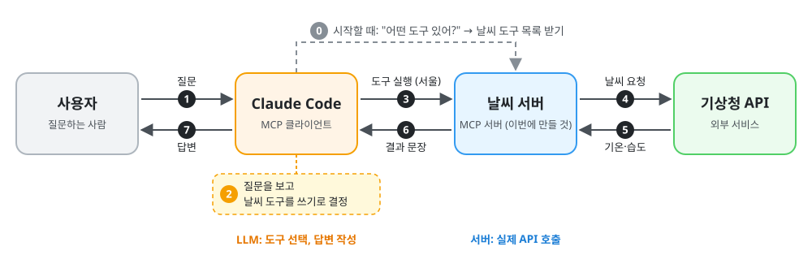
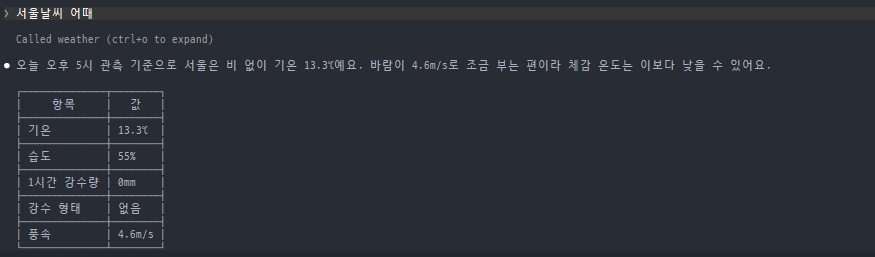

## 들어가며

요즘 "우리 제품을 LLM에 붙일 수 있을까?"라는 이야기가 자주 나옵니다. 사용자가 "취약한 서버 목록 보여줘"라고 말하면 LLM이 알아서 우리 API를 호출해 답해 주는 그림입니다.

그런데 LLM마다 외부 기능을 붙이는 방식이 제각각이면, 모델이 바뀔 때마다 연동을 다시 만들어야 합니다. 이 문제를 풀려고 나온 표준이 **MCP(Model Context Protocol)** 입니다.

이 글은 MCP를 처음 공부하면서 정리한 내용입니다. 앞부분에서는 MCP의 개념을, 뒷부분에서는 가장 작은 예제로 **"현재 날씨를 알려주는 도구"를 Spring Boot로 만들어 Claude Code에서 써 보는 과정**을 다룹니다.

---

## 1. MCP란?

MCP는 LLM 애플리케이션이 외부 도구와 데이터를 **같은 방식으로** 쓸 수 있게 해 주는 공개 프로토콜입니다. 2024년 11월 Anthropic이 공개했고, 지금은 여러 LLM 앱이 지원하고 있습니다.

공식 문서는 MCP를 USB-C에 비유합니다. 기기마다 다른 케이블 대신 USB-C 하나로 연결하듯, 도구를 MCP 규격으로 한 번 만들어 두면 MCP를 지원하는 어떤 LLM 앱에서도 쓸 수 있습니다.

### 1-1. 왜 필요할까?

LLM 앱이 M개, 연결하고 싶은 서비스가 N개라고 해 보겠습니다. 표준이 없으면 앱과 서비스의 조합마다 연동을 따로 만들어야 해서 최대 M × N개의 연동이 필요합니다.

MCP가 있으면 서비스는 MCP 서버를 한 번만 만들고, 앱은 MCP 클라이언트를 한 번만 구현하면 됩니다. 필요한 연동이 M + N개로 줄어듭니다.

| | 표준이 없을 때 | MCP가 있을 때 |
|---|---|---|
| 서비스 쪽 | 앱마다 연동을 따로 개발 | MCP 서버 하나 |
| 앱 쪽 | 서비스마다 연동을 따로 개발 | MCP 클라이언트 하나 |
| 모델을 바꾸면 | 연동을 다시 개발 | 그대로 사용 |

### 1-2. 구성 요소: 호스트, 클라이언트, 서버

| 구성 요소 | 하는 일                                                    | 예                                            |
|---|---------------------------------------------------------|----------------------------------------------|
| **호스트(Host)** | 사용자가 직접 쓰는 LLM 앱                                        | Claude Code, Claude Desktop, ChatGPT, Cursor |
| **클라이언트(Client)** | 호스트 안에서 MCP 서버 하나와 연결을 맺고 메시지를 주고받는 부분. 서버 하나당 클라이언트 하나 | 호스트에 내장                                      |
| **서버(Server)** | 도구와 데이터를 제공하는 프로그램 **이 글에서 만듦**                         | 날씨 서버, 사내 API 서버, 파일시스템 서버 등                 |

글에서는 편의상 호스트와 클라이언트를 묶어 "클라이언트"라고 부르겠습니다.

### 1-3. 서버가 제공하는 것: Tools, Resources, Prompts

| 기능 | 설명 | 누가 쓰나 |
|---|---|---|
| **Tools(도구)** | LLM이 호출하는 함수. 예: 날씨 조회, 자산 검색 | LLM이 판단해서 호출 |
| **Resources(리소스)** | 읽기 전용 데이터 예: 파일 내용, 문서 | 앱이나 사용자가 골라서 첨부 |
| **Prompts(프롬프트)** | 미리 만들어 둔 프롬프트 템플릿 | 사용자가 골라서 사용 |

가장 많이 쓰는 것은 **Tools**이고, 이 글도 Tools만 다룹니다.

### 1-4. 통신 방식: JSON-RPC와 전송 방식

클라이언트와 서버는 **JSON-RPC 2.0** 형식의 메시지를 주고받습니다. 주요 메시지는 다음과 같습니다.

- `initialize`: 연결을 시작하면서 서로 지원하는 기능을 확인
- `tools/list`: 서버에 어떤 도구가 있는지 조회
- `tools/call`: 도구 실행

메시지를 실어 나르는 **전송 방식(Transport)** 은 두 가지입니다.

| 방식 | 동작 | 언제 쓰나 |
|---|---|---|
| **stdio** | 클라이언트가 서버 프로그램을 직접 실행하고 표준입출력(stdin/stdout)으로 통신 | 내 PC에서 혼자 쓸 때. 가장 간단 |
| **Streamable HTTP** | 서버를 웹 서버로 띄워 두고 URL로 접속 | 여러 사람이 서버 하나를 같이 쓸 때, 원격 서버에 배포할 때 |

이 글에서는 가장 간단한 **stdio**를 씁니다.

### 1-5. 동작 흐름

"서울 날씨 어때?"라고 물었을 때 일어나는 일을 그려 보면 다음과 같습니다.



| 단계 | 무슨 일이 일어나나 | MCP 용어 |
|---|---|---|
| 0 | Claude Code가 켜질 때 날씨 서버에 어떤 도구가 있는지 묻고, 서버는 도구 이름과 설명을 알려 줍니다 | `tools/list` |
| 1 | 사용자가 "서울 날씨 어때?"라고 질문합니다 | |
| 2 | Claude가 질문과 도구 설명을 비교해 날씨 도구를 쓰기로 정합니다. 도시 이름("서울")도 질문에서 뽑아냅니다 | |
| 3 | Claude Code가 날씨 서버에 도구 실행을 요청합니다 | `tools/call` |
| 4~5 | 날씨 서버가 기상청 API를 호출해 기온, 습도 같은 데이터를 받아 옵니다 | 도구 내부 구현 |
| 6 | 날씨 서버가 결과를 문장으로 돌려줍니다 | |
| 7 | Claude가 결과를 보고 사람이 읽기 좋게 답합니다 | |

정리하면 **기상청을 부르는 일은 날씨 서버가 하고, 어떤 도구를 쓸지 정하고 답을 만드는 일은 LLM이 합니다.**

 **LLM이 도구를 고를 때 보는 것은 도구의 이름과 설명, 입력값 설명뿐입니다.** 설명을 어떻게 쓰느냐가 도구가 잘 쓰이느냐를 좌우합니다.

---

## 2. Spring Boot로 MCP 서버 만들기

이제 직접 만들어 보겠습니다. 환경은 다음과 같습니다.

- Java 17
- Spring Boot 4.1
- Spring AI 2.0 (MCP 서버 스타터)

### 2-1. 프로젝트 설정

Spring Initializr에서 프로젝트를 만들고 의존성을 추가합니다.

```groovy
ext {
    set('springAiVersion', "2.0.1")
}

dependencies {
    implementation 'org.springframework.ai:spring-ai-starter-mcp-server'
    implementation 'com.fasterxml.jackson.core:jackson-databind'
}

dependencyManagement {
    imports {
        mavenBom "org.springframework.ai:spring-ai-bom:${springAiVersion}"
    }
}
```

`application.properties`는 이렇게 씁니다.

```properties
spring.application.name=mcp-weather

# 웹 서버는 띄우지 않는다. stdio 방식이라 표준입출력으로만 통신
spring.main.web-application-type=none

# stdio 방식에서는 stdout 이 곧 통신 채널이라, 배너와 콘솔 로그가 섞이면 통신이 깨진다
spring.main.banner-mode=off
logging.pattern.console=

# MCP 서버 정보
spring.ai.mcp.server.name=ssr-weather
spring.ai.mcp.server.version=0.0.1
spring.ai.mcp.server.stdio=true

# 기상청 API 키는 환경변수로 받는다
kma.service-key=${KMA_SERVICE_KEY:}
```

`banner-mode=off`와 `logging.pattern.console=`가 없으면 Spring 배너와 로그가 stdout으로 나갑니다. 그러면 클라이언트는 MCP 메시지가 아닌 글자를 받게 되고 연결이 깨집니다. 같은 이유로 코드에서 `System.out.println`도 쓰면 안 됩니다.

### 2-2. 도구 만들기: `@Tool`

날씨 데이터는 공공데이터포털의 **기상청 단기예보 조회서비스 중 초단기실황(getUltraSrtNcst)** 을 썼습니다. 무료로 키를 발급받을 수 있습니다.

Spring AI에서는 메서드에 `@Tool`만 붙이면 MCP 도구가 됩니다.

```java
@Service
public class WeatherService {

    private static final String WEATHER_API_URL =
            "https://apis.data.go.kr/1360000/VilageFcstInfoService_2.0/getUltraSrtNcst";

    // 기상청은 위경도가 아니라 격자 좌표(nx, ny)를 쓴다
    private static final Map<String, int[]> CITY = new LinkedHashMap<>();
    static {
        CITY.put("서울", new int[]{60, 127});
        CITY.put("부산", new int[]{98, 76});
        // ... 나머지 도시
    }

    private final HttpClient httpClient = HttpClient.newHttpClient();
    private final ObjectMapper objectMapper = new ObjectMapper();
    private final String serviceKey;

    public WeatherService(@Value("${kma.service-key}") String serviceKey) {
        this.serviceKey = serviceKey;
    }

    @Tool(description = "한국 주요 도시의 현재 날씨(기온, 습도, 1시간 강수량, 강수 형태, 풍속)를 "
            + "기상청 초단기실황 API로 조회한다. 지원 도시: 서울, 인천, 대전, 대구, 광주, 부산, 울산, 제주")
    public String getCurrentWeather(
            @ToolParam(description = "도시 이름. 예: 서울, 부산") String city) throws Exception {

        // "서울시", "부산이요"처럼 들어와도 찾을 수 있게 contains 로 비교
        String cityName = null;
        int[] grid = null;
        for (Map.Entry<String, int[]> entry : CITY.entrySet()) {
            if (city != null && city.contains(entry.getKey())) {
                cityName = entry.getKey();
                grid = entry.getValue();
                break;
            }
        }
        if (grid == null) {
            return "지원하지 않는 도시입니다: " + city + ". 지원 도시: " + String.join(", ", CITY.keySet());
        }

        // 초단기실황은 정각 자료가 약 40분 뒤에 나온다
        LocalDateTime base = LocalDateTime.now(ZoneId.of("Asia/Seoul")).minusMinutes(40);
        String baseDate = base.format(DateTimeFormatter.ofPattern("yyyyMMdd"));
        String baseTime = base.format(DateTimeFormatter.ofPattern("HH")) + "00";

        String url = WEATHER_API_URL
                + "?serviceKey=" + serviceKey
                + "&pageNo=1&numOfRows=100&dataType=JSON"
                + "&base_date=" + baseDate + "&base_time=" + baseTime
                + "&nx=" + grid[0] + "&ny=" + grid[1];

        String body = httpClient.send(HttpRequest.newBuilder(URI.create(url)).GET().build(),
                HttpResponse.BodyHandlers.ofString()).body();

        // 키 오류 같은 응답은 JSON 이 아니라 XML 로 온다
        if (!body.trim().startsWith("{")) {
            return "기상청 API 오류 응답: " + body;
        }

        // ... JSON 에서 기온(T1H), 습도(REH), 강수량(RN1), 강수형태(PTY), 풍속(WSD) 을 꺼내 문장으로 만든다
        return cityName + " 현재 날씨 ...";
    }
}
```

눈여겨볼 부분은 세 가지입니다.

- **메서드 이름이 도구 이름이 됩니다.** 이 도구의 이름은 `getCurrentWeather`입니다.
- **`description`은 LLM이 읽는 설명서입니다.** 언제 이 도구를 써야 하는지, 어떤 도시를 지원하는지 적어 두면 LLM이 알맞게 고릅니다.
- **오류도 문장으로 돌려줍니다.** 예외를 던지는 대신 "지원하지 않는 도시입니다. 지원 도시: …"처럼 돌려주면, LLM이 이 문장을 읽고 사용자에게 다시 물어볼 수 있습니다.

### 2-3. 도구 등록과 빌드

만든 클래스를 MCP 도구로 등록합니다.

```java
@SpringBootApplication
public class McpWeatherApplication {

    public static void main(String[] args) {
        SpringApplication.run(McpWeatherApplication.class, args);
    }

    // WeatherService 안의 @Tool 메서드를 찾아 MCP 도구로 등록
    @Bean
    public ToolCallbackProvider weatherTools(WeatherService weatherService) {
        return MethodToolCallbackProvider.builder()
                .toolObjects(weatherService)
                .build();
    }
}
```

도구 클래스가 늘어나면 `.toolObjects(weatherService, otherService)`처럼 추가하면 됩니다.

빌드하면 jar 파일이 생깁니다.

```bash
./gradlew bootJar
# build/libs/mcp-weather-0.0.1-SNAPSHOT.jar
```

---

## 3. Claude Code에 연결하기

### 3-1. `.mcp.json` 작성

프로젝트 폴더에 `.mcp.json`을 만들면 Claude Code가 이 서버를 실행합니다.

```json
{
  "mcpServers": {
    "weather": {
      "command": "java",
      "args": [
        "-Dfile.encoding=UTF-8",
        "-Dstdout.encoding=UTF-8",
        "-jar",
        "<jar 파일 경로>/mcp-weather-0.0.1-SNAPSHOT.jar"
      ],
      "env": {
        "KMA_SERVICE_KEY": "<발급받은 기상청 API 키>"
      }
    }
  }
}
```

> API 키가 들어 있으니 `.mcp.json`은 git에 올리지 않도록 주의

### 3-2. 연결 확인

Claude Code를 실행하고 `/mcp`를 입력하면 `weather` 서버가 연결됐는지 확인할 수 있습니다.

<!-- TODO: /mcp 화면 캡처 (키, 경로가 보이지 않게)

-->

### 3-3. 실행해 보기

"서울 날씨 어때?"라고 물어보면 Claude가 `getCurrentWeather` 도구를 호출하고 결과를 바탕으로 답합니다.

<!-- TODO: "서울 날씨 어때?" 실행 화면 캡처

-->

---

## 4. 막혔던 점

### 4-1. stdout에 뭔가 찍히면 연결이 끊긴다

처음에는 서버가 바로 연결이 끊겼습니다. 원인은 Spring 배너였습니다. stdio 방식에서는 stdout이 통신 채널이라, 배너나 로그 한 줄만 섞여도 클라이언트가 메시지를 해석하지 못합니다. `spring.main.banner-mode=off`와 `logging.pattern.console=`로 해결했습니다.

### 4-2. Windows에서 한글이 깨진다

Windows에서는 도구 결과의 한글이 깨져서 LLM에 전달됐습니다. Java 실행 인자에 `-Dfile.encoding=UTF-8 -Dstdout.encoding=UTF-8`을 넣어 해결했습니다.

### 4-3. Jackson 패키지가 다르다

Spring Boot 4 / Spring AI 2.x는 Jackson 3를 씁니다. `ObjectMapper`, `JsonNode`의 패키지가 `com.fasterxml.jackson.databind`가 아니라 `tools.jackson.databind`입니다. 예전 예제를 그대로 따라 하면 import에서 막힐 수 있습니다.

### 4-4. 기상청 API의 소소한 함정

- 키가 잘못되면 `dataType=JSON`을 줘도 XML로 오류가 옵니다. JSON 파싱 전에 응답이 `{`로 시작하는지 먼저 확인했습니다.
- 초단기실황은 정각 자료가 약 40분 뒤에 올라옵니다. 현재 시각을 그대로 쓰면 자료가 없어서, 40분을 빼고 정각으로 맞췄습니다.

---

## 마치며

- MCP는 LLM 앱이 외부 도구를 같은 방식으로 쓰게 해 주는 표준입니다.
- 구성 요소는 호스트, 클라이언트, 서버이고, 서버는 Tools, Resources, Prompts를 제공합니다.
- Spring AI에서는 `@Tool` 하나로 메서드를 MCP 도구로 만들 수 있습니다.
- stdio 방식은 설정이 간단하지만 stdout을 깨끗하게 지켜야 합니다.
- LLM이 도구를 고를 때 보는 것은 이름과 설명뿐이므로, 설명을 잘 쓰는 것이 중요합니다.

공부하면서 도구 설계, 인증, 원격 서버 방식 같은 내용을 이어서 정리해 보겠습니다.

## 참고

- [Model Context Protocol 공식 문서](https://modelcontextprotocol.io)
- [Spring AI MCP Server 문서](https://docs.spring.io/spring-ai/reference/api/mcp/mcp-server-boot-starter-docs.html)
- [공공데이터포털 - 기상청 단기예보 조회서비스](https://www.data.go.kr/data/15084084/openapi.do)
